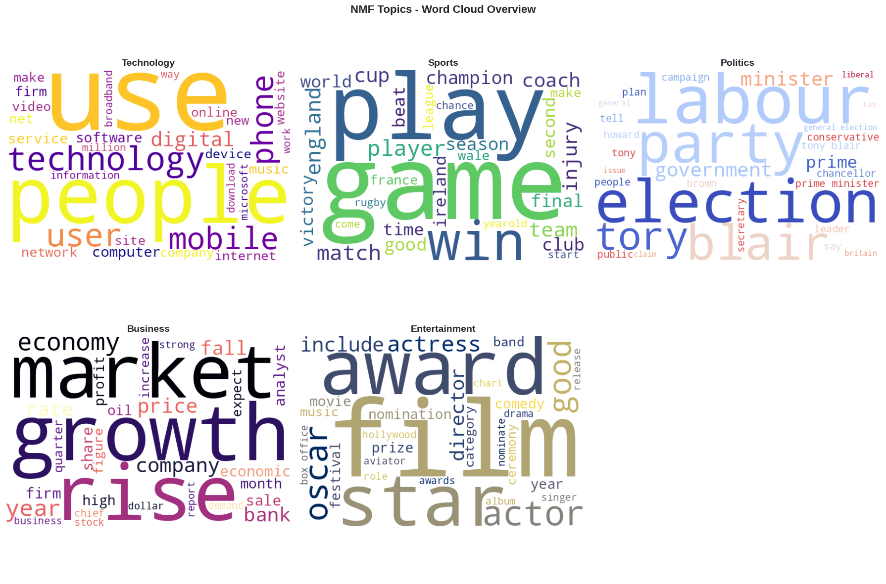
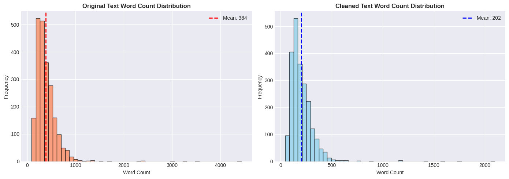
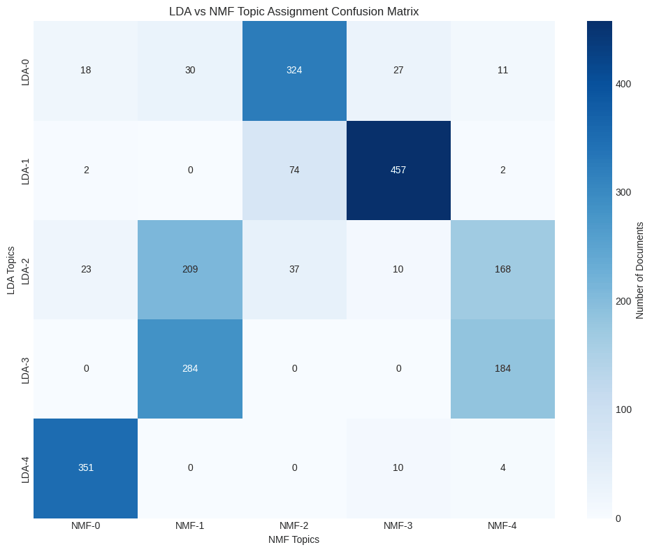

# Topic Modeling of News Articles with LDA and NMF

An end-to-end **unsupervised topic modeling pipeline** for news articles. Using the **BBC News dataset** (2,225 articles), it compares two classic algorithms, **Latent Dirichlet Allocation (LDA)** and **Non-Negative Matrix Factorization (NMF)**, after a multi-stage NLP preprocessing step with spaCy lemmatization.

This repository accompanies the paper:

> **Automated Topic Modeling and Comparative Analysis of News Articles using LDA and NMF**
> Ece Akın — Computer Engineering, İzmir Katip Çelebi University

<p align="center">
  
</p>

---

## Contents

- [Highlights](#highlights)
- [Pipeline](#pipeline)
- [Results](#results)
- [Getting started](#getting-started)
- [Outputs](#outputs)
- [Future work](#future-work)
- [References](#references)

---

## Highlights

- **Preprocessing** cuts the average article from **384 to 202.5 words (−47.3%)** while keeping the topical vocabulary
- **Two vectorizations**: raw term counts for LDA and sublinear **TF-IDF** for NMF, both with unigrams and bigrams
- **Both models recover the five editorial categories** of the dataset (politics, business, technology, sport, entertainment) without using the labels
- **NMF converges in about 35 iterations (≈0.3 s)**, while LDA takes ≈16 s for 20 passes
- **Interactive pyLDAvis** map of inter-topic distances, plus word clouds and bar charts for every topic

## Pipeline

```
 BBC News CSV ──► Preprocessing ──► Vectorization ──► Topic models ──► Visualization
 (2,225 docs)     clean, tokenize,   CountVectorizer ──► LDA          pyLDAvis (t-SNE)
                  stop words,        TfidfVectorizer ──► NMF          word clouds
                  spaCy lemmas                                        bar charts
```

### 1. Text preprocessing

| Step | Details |
|---|---|
| Basic cleaning | Lowercasing; removal of URLs, email addresses and HTML tags with regular expressions |
| Noise removal | Numbers, punctuation and extra whitespace removed |
| Tokenization | NLTK `word_tokenize` |
| Stop-word removal | NLTK English list plus domain-specific words (`said`, `would`, `could`, `also`, `one`, `two`, `may`) |
| Lemmatization | spaCy `en_core_web_sm` (parser and NER disabled for speed); NLTK WordNet as a fallback |
| Filtering | Tokens shorter than 3 characters dropped |

<p align="center">
  
</p>

### 2. Feature engineering

Both vectorizers share the same vocabulary settings so the two models see comparable features:

| Parameter | Value |
|---|---|
| `max_features` | 5,000 |
| `ngram_range` | (1, 2) |
| `min_df` / `max_df` | 5 documents / 85% of documents |
| `token_pattern` | Alphabetic tokens of 3+ characters |

- **LDA** uses `CountVectorizer`, because it models raw word counts.
- **NMF** uses `TfidfVectorizer` with `sublinear_tf=True` (1 + log tf), which down-weights very frequent terms.

The resulting document-term matrices are 2,225 × 5,000 and 97.78% sparse.

### 3. Topic models

| | LDA | NMF |
|---|---|---|
| Implementation | `sklearn.decomposition.LatentDirichletAllocation` | `sklearn.decomposition.NMF` |
| Input | Term counts | TF-IDF |
| Topics (K) | 5 | 5 |
| Key settings | Online variational Bayes, 20 iterations, batch size 128, learning offset 50 | NNDSVD initialization, up to 500 iterations |
| Random state | 42 | 42 |

Topics are labelled manually by inspecting their top words.

## Results

### Model metrics

| Metric | LDA | NMF |
|---|---|---|
| Training time | ≈16.4 s | ≈0.28 s |
| Convergence | 20 iterations | ≈35 iterations |
| Fit metric | Perplexity **1687.43**, log-likelihood −2.76 M | Reconstruction error **45.17** |
| Mean dominant-topic probability | 0.777 | — |

### Discovered topics (top words)

| Theme | LDA | NMF |
|---|---|---|
| Politics | labour, party, say, government, election, blair, minister | labour, election, party, blair, tory, government, minister |
| Business | year, company, rise, market, government, firm, bank, economy | growth, rise, market, economy, year, price, company, bank |
| Technology | use, people, mobile, technology, phone, service, user | use, people, technology, user, mobile, phone, digital, computer |
| Sport | game, make, play, time, year, new, people, player | game, play, win, player, match, england, team, cup |
| Entertainment | film, good, win, year, award, play, world, england | film, award, star, actor, oscar, good, actress |

**Takeaways**

- Both models find the same five themes, matching the dataset's editorial categories.
- **LDA** surfaces broad, high-frequency words (`year`, `say`, `make`) and mixes some sport vocabulary into the entertainment topic.
- **NMF with TF-IDF** gives sharper, more specific topics built around distinctive nouns (`oscar`, `actress`, `tory`, `broadband`).
- pyLDAvis shows the five LDA topics well separated in the 2-D inter-topic distance map.

<p align="center">
  
</p>

The matrix above counts, for every document, its dominant LDA topic against its dominant NMF topic. Politics, business and technology line up strongly between the two models; sport and entertainment documents are split across two LDA topics.

## Getting started

The notebook was developed on Kaggle with Python 3.12 and also runs locally or on Google Colab.

```bash
git clone https://github.com/eceakin/topic-modeling-nlp.git
cd topic-modeling-nlp

python -m venv .venv
source .venv/bin/activate        # Windows: .venv\Scripts\activate

pip install -r requirements.txt
python -m spacy download en_core_web_sm

jupyter notebook topic_modeling_bbc_news.ipynb
```

Run the cells from top to bottom. The first run downloads the dataset (`bbc_text_cls.csv`, columns `text` and `labels`) and the required NLTK resources automatically.

Main settings can be changed at the top of each step:

| Setting | Where | Default |
|---|---|---|
| `USE_SPACY`, `MIN_TOKEN_LENGTH` | Step 4 – preprocessing | `True`, `3` |
| `MAX_FEATURES`, `MIN_DF`, `MAX_DF`, `NGRAM_RANGE` | Step 5 – vectorization | `5000`, `5`, `0.85`, `(1, 2)` |
| `N_TOPICS_LDA`, `N_TOP_WORDS` | Step 6 – LDA | `5`, `15` |
| `N_TOPICS_NMF`, `N_TOP_WORDS_NMF` | Step 7 – NMF | `5`, `15` |

## Outputs

Running the notebook writes the following to the working directory (they are git-ignored):

| Output | Contents |
|---|---|
| `preprocessed_articles.csv` | Original and cleaned text with word counts |
| `tfidf_vectorizer.pkl`, `count_vectorizer.pkl` | Fitted vectorizers |
| `lda_model.pkl`, `nmf_model.pkl` | Trained models (labels in `lda_topic_labels.pkl`, `nmf_topic_labels.pkl`) |
| `lda_doc_topic_dist.npy`, `nmf_doc_topic_dist.npy` | Document-topic distributions |
| `topic_assignments.csv` | Dominant topic per article for both models |
| `lda_visualization.html` | Interactive pyLDAvis map |
| `wordclouds/`, `bar_charts/` | Per-topic word clouds, bar charts and LDA-vs-NMF comparisons |
| `topic_modeling_summary.txt` | Text summary report |

## Future work

- Replace bag-of-words features with **transformer embeddings** (e.g. BERT) to capture context
- **Dynamic topic modeling** to follow how news themes change over time
- Quantitative evaluation with **topic coherence** scores and alignment with the ground-truth labels

## References

1. D. M. Blei, A. Y. Ng and M. I. Jordan, "Latent Dirichlet Allocation," *Journal of Machine Learning Research*, 2003.
2. D. D. Lee and H. S. Seung, "Learning the parts of objects by non-negative matrix factorization," *Nature*, 1999.
3. D. Greene and P. Cunningham, "Practical solutions to the problem of diagonal dominance in kernel document clustering," *ICML*, 2006. (BBC News dataset)
